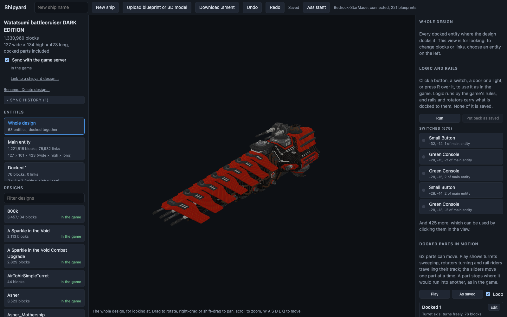
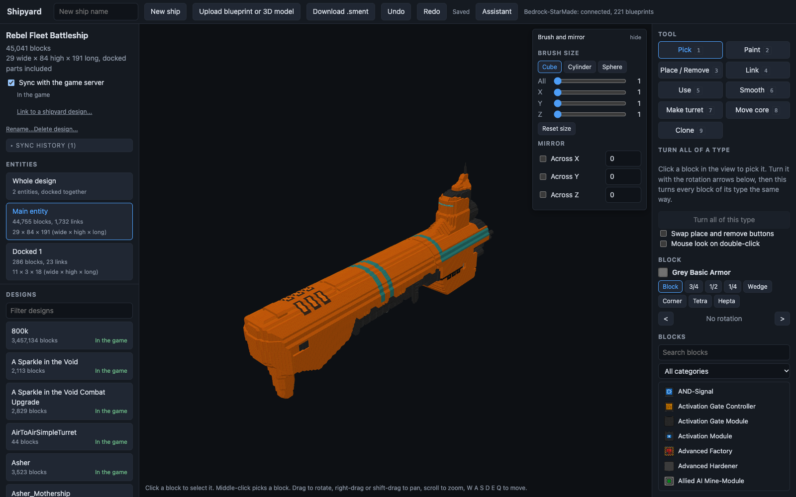
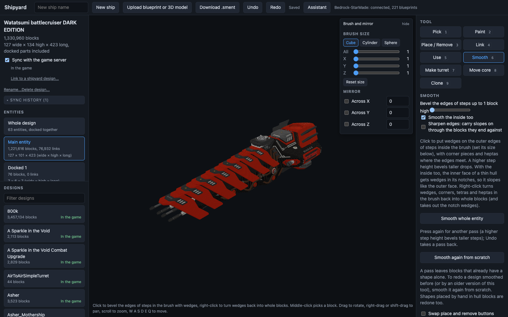
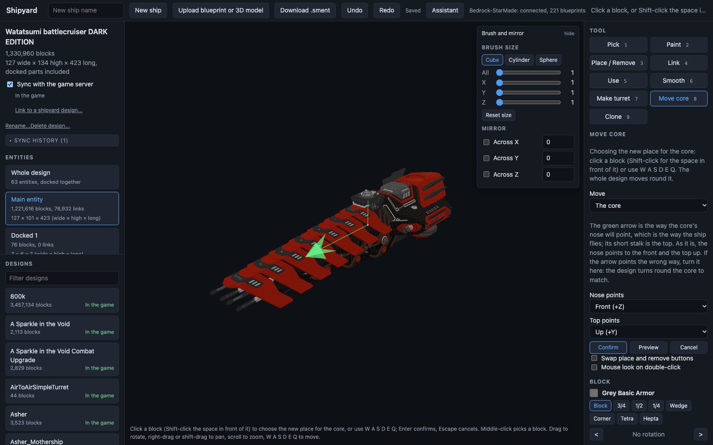
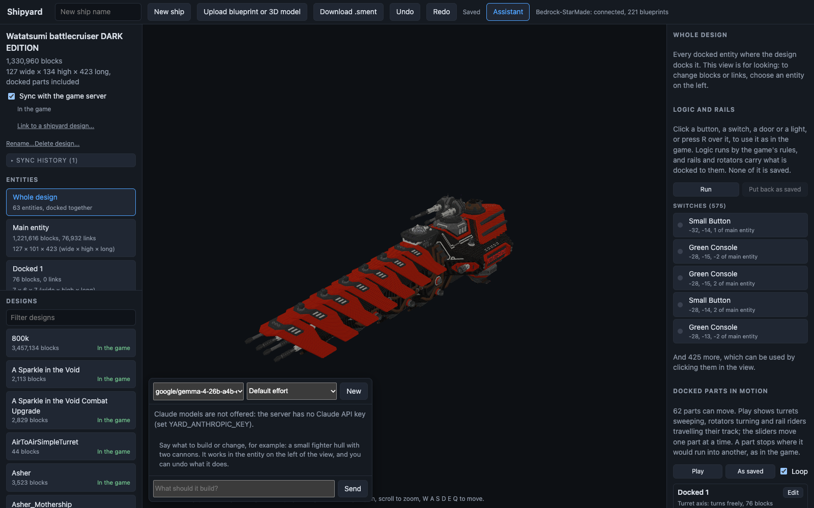
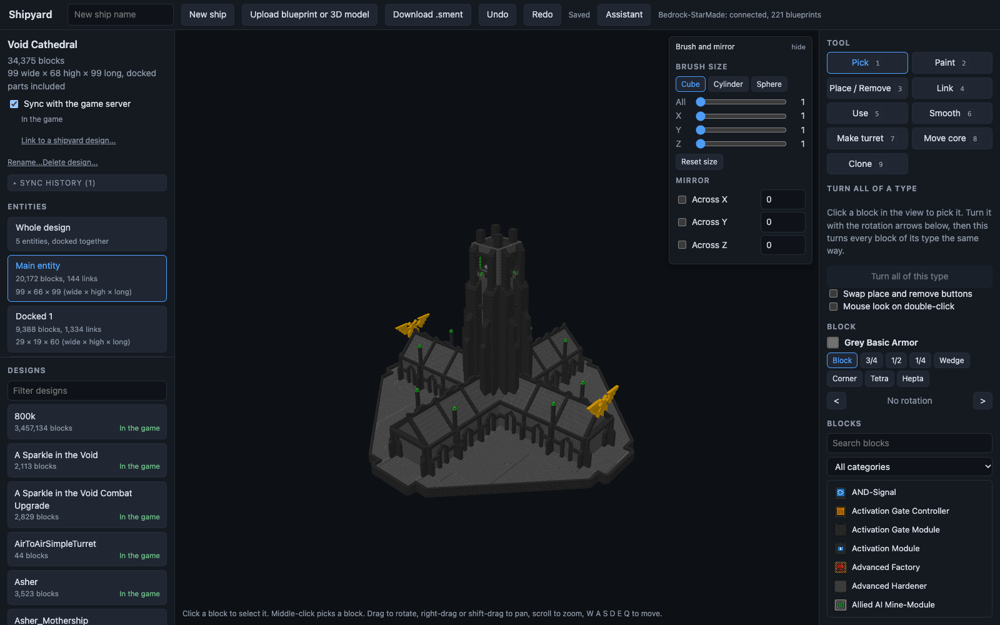
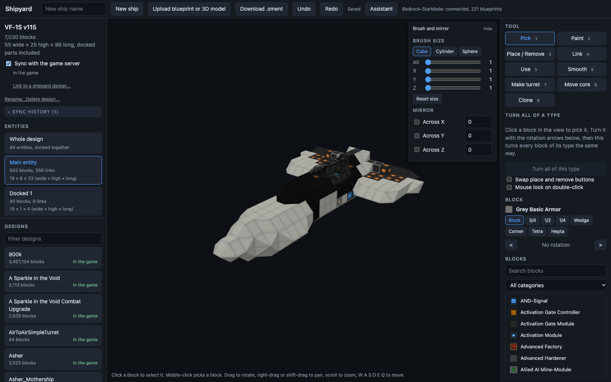
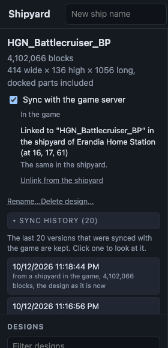

# StarMade Shipyard Helper

Two parts that work together:

- **A web shipyard** (`rust/`): open a StarMade blueprint in the browser, look at it in 3D with the game's own textures, edit it with build-mode tools, smooth hulls, move the core, cut out turrets, import 3D models, chat with an assistant that builds for you, and download it as a `.sment` the game imports.
- **A server mod** (`src/`): keeps the game server's blueprint catalog and the designs held in its shipyards in step with the web shipyard, and gives players an in-game `/yard <what to build>` assistant.



## Install

Download the [latest release](https://github.com/Daeden-JL/StarMade_Shipyard_Helper/releases/latest).

**Web shipyard.** Unpack `shipyard-<version>-<os>-<arch>.tar.gz` and run

```
./start.sh /path/to/StarMade
```

where the path is the game install that holds `data/` and `version.txt` (the shipyard reads block definitions, textures and models from it; nothing of the game ships here). Then open http://127.0.0.1:4280. Add `0.0.0.0:4280` as a second argument to serve the whole network. Packages are built for Linux (x86_64, arm64) and macOS (Apple silicon); on other systems build from source as described in [`rust/README.md`](rust/README.md).

**Server mod.** Copy `StarMade_Shipyard_Helper-<version>.jar` into the game server's `mods/` folder and start the server once; it writes `moddata/StarMade_Shipyard_Helper/config.properties`. Set `sync.url` there to the web shipyard's address as the game server reaches it, for example `http://192.168.1.10:4280`, and restart. Clients do not need the mod.

## Screenshots

| | |
|---|---|
|  Build tools, brush and mirror, block palette |  Hull smoothing with wedges, corners, tetras and heptas |
|  Moving the core, with the nose and top directions shown |  The assistant: a local model or Claude builds in the open design |
|  A station with docked parts |  A fighter with 44 docked entities |



**Game server sync.** With the mod installed, every blueprint in the server's catalog appears in the web shipyard and edits go both ways. A design can be linked to a design held in a game shipyard: blocks placed in the game show up in the browser within seconds, and edits made in the browser replace the design in the shipyard. The last 20 synced versions are kept and any of them can be opened or restored.

<br clear="all">

## The server mod

The mod's assistant lets players talk to a locally hosted model to design ships and turrets inside a shipyard design. Players type `/yard <what to build>` while editing a design; the agent places blocks, links systems and reports back in chat. The blueprint sync runs on a live 0.304.7 server; the in-game assistant is tested offline against a real local model, and the checks under "What is not verified yet" are for it.

## How it works

- The model never places blocks one by one. It calls a small set of tools (`fill`, `cylinder`, `ellipsoid`, `line`, `place_blocks`, `replace`, `remove`, `set_symmetry`, `link`, `scan`, `find_blocks`, ...) and deterministic code turns those into blocks.
- Everything the agent does goes through `DesignWorld`. `InMemoryDesignWorld` backs the tests and the offline harness; `LiveDesignWorld` wraps a shipyard design entity in the game and refuses anything that is not a virtual blueprint, so the agent cannot touch real ships or stations.
- One session per player, one player per design. A second player asking on the same design is refused until the first has left it.
- Model calls run on worker threads. Every read and write of game state is handed to the server tick thread and limited per tick (`world.blocksPerTick`).
- Each request is one undo step (`/yard undo`).
- Requests are screened for NSFW content before the agent sees them (word list, then a one-word verdict from the model, then the agent's own instructions).

## Commands

| Command | What it does |
|---|---|
| `/yard <message>` | Ask the assistant to build or change something. Only works inside a shipyard design in build mode. |
| `/yard undo` | Take back the last request. |
| `/yard stop` | Cancel the running request. |
| `/yard status`, `/yard reset`, `/yard help` | Session state, clear the conversation, usage. |
| `/yard_debug ...` | Admin only. Self-checks that need a running game (see below). |

## Build

Needs JDK 21 and the game's jars in `libs/` (not redistributable, gitignored): `StarMade.jar`, `vecmath.jar`, `jbullet.jar`, `fastutil-6.5.0.jar` from a 0.304.7 install.

```
make test     # unit tests
make build    # build/libs/StarMade_Shipyard_Helper-<version>.jar
```

Install by copying the jar into the server's `mods/` folder. Clients do not need it.

## Configuration

`moddata/StarMade_Shipyard_Helper/config.properties` is written with defaults on first start.

| Key | Default | Notes |
|---|---|---|
| `llm.baseUrl` | `http://127.0.0.1:1234/v1` | Any OpenAI-compatible endpoint. From the game container this must be an address the container can reach, not 127.0.0.1. |
| `llm.model` | `google/gemma-4-26b-a4b-qat` | Must support tool calling. |
| `llm.reasoningEffort` | empty | `none` is several times faster but builds less carefully; empty leaves it to the model server. |
| `llm.maxTokens` | `3000` | Per model call, reasoning included. Must be reachable within `llm.timeoutSeconds` (300) at the model server's speed under load. |
| `llm.maxConcurrent` | `2` | Requests sent to the model at once; other players queue. Match the model server's parallel setting. |
| `agent.maxSteps` | `40` | Model calls per request. |
| `agent.maxBlocksPerOperation` | `200000` | |
| `agent.trace` | `false` | Log every model step and tool call. |
| `world.blocksPerTick` | `2000` | |
| `world.writeMode` | `processor` | `processor` or `direct`; see below. |
| `world.buildHalfExtent` | `250` | Build area around the core. |
| `session.idleMinutes` | `10` | |
| `filter.enabled` | `true` | |

The model server must have the model loaded (LM Studio answers "Model is unloaded" otherwise) and must listen on the network if the game runs in a container or VM.

## Blueprint sync with the web shipyard

With `sync.url` set, the mod keeps the game's blueprint catalog and the web shipyard (`rust/`) in step. It is off by default.

- Every `sync.intervalSeconds` the mod tells the shipyard which blueprints are in `blueprints/`, each with a fingerprint of its files. The shipyard answers with the blueprints it wants uploaded and the designs it wants put into the game. The shipyard remembers what was exchanged; the mod keeps nothing between runs.
- A blueprint saved in the game shows up in the shipyard as a design. A design made or edited in the shipyard shows up in the game's catalog without a restart. A blueprint deleted in the game stays in the shipyard and is not sent back.
- A design from the shipyard that is new to the game gets `sync.owner` as its catalog owner, and with `sync.othersCanBuy` every player can see and buy it. A design that replaces an existing blueprint keeps that entry's owner, description, lock and permissions; only price, mass and score are brought up to date.
- Nothing is deleted. A blueprint that is replaced is moved to `moddata/StarMade_Shipyard_Helper/sync/replaced/<name>.<time>` (the newest three per name are kept). A design the game cannot read is taken out again, the previous version is put back, and that version of the design is not tried again until the mod restarts.
- A blueprint the game is in the middle of saving is reported as busy and left alone until it has been quiet for five seconds.
- Reading, packing and network traffic run on the mod's own thread. Putting a blueprint in place and listing it in the catalog runs on the server thread and took 3 to 6 ms in tests.

| Key | Default | Notes |
|---|---|---|
| `sync.url` | empty | Address of the shipyard as the game server reaches it, for example `http://192.168.1.10:4280`. Empty turns the sync off. |
| `sync.token` | empty | Must equal the shipyard's `YARD_SYNC_TOKEN` if that is set. Never logged. |
| `sync.intervalSeconds` | `10` | |
| `sync.serverName` | `StarMade server` | How this server is named in the shipyard. |
| `sync.owner` | `Shipyard` | Catalog owner of blueprints that come from the shipyard. |
| `sync.othersCanBuy` | `true` | Whether players other than that owner may buy them. |
| `sync.shipyards` | `owner` | Which shipyards designs may be linked to: `owner` for shipyards on stations of `sync.owner`'s faction, `all` for every shipyard, `off` for none. The game checks no permissions for shipyard orders the server gives, so `all` lets anyone with the web shipyard replace designs in any shipyard. |

Limits: names must follow the game's own rule (letters, digits, `_`, `-`, spaces, no dots) and be at most 128 characters; other folders are ignored. A blueprint named `<x>Tmp` next to a blueprint named `<x>` is never exchanged, because that is what a save in progress looks like. Blueprints over 256 MB packed are left out.

The mod also reports the shipyards on loaded stations, and for designs linked in the web shipyard to a shipyard design it copies the loaded design out as a blueprint when it changed (once left alone for 10 s and with every docked part in place; the game's own "fully loaded" flag is not waited for, since it can stay off for good on a large design read from disk, and a copy is taken from the design's files after the game has written what it holds in memory) and replaces it with a design made from the catalog when the web shipyard has a newer version: unload, make the new design with the game's own "catalog to design" order, then remove the old one. The rules are in `rust/README.md` under "Designs in game shipyards". Started with `-Dyard.debug=true`, the mod also asks the game to read the blocks of stations and designs that have none in memory, so a server with no player near a station can still be tested; do not use that on a live server.

Checked: unit tests for the fingerprint, listing, packing and the exchange (`src/test/java/.../sync`); the agent with the real catalog code on the game's own classes (new entry, update that keeps owner and description, unreadable design taken back out); the same against a running shipyard server; and inside a running throwaway 0.304.7 server: its blueprints reached the shipyard, a design made in the shipyard was listed by the game's own `/list_blueprints_verbose` with the configured owner, spawned with `/spawn_entity`, was still there after a restart with nothing sent twice, and the server shut down cleanly. With 210 blueprints in the folder, listing a new or changed one held the server thread for 3 to 10 ms. Not checked: what a connected client's catalog shows, and an in-game save racing the agent (the save sequence was imitated with folder renames).

## Offline harness

Chat with the agent against an in-memory design, no game needed:

```
make cli                                   # interactive
./gradlew -q cli --args="--catalog <dir with BlockConfig.xml> --prompt 'build a small fighter' --effort none"
```

It prints every model step and tool call, and `:slice [y]`, `:side`, `:info`, `:undo` show the result.

## What is not verified yet

These need a running 0.304.7 server and a client, and are what `/yard_debug` is for:

1. `/yard_debug where` - the mod finds the design the player is editing.
2. `/yard_debug axes` - red points right (+X), green up (+Y), blue forward (+Z).
3. `/yard_debug cube processor 20` and `/yard_debug cube direct 20` - blocks appear on the client without relogging, including in new segments; note the blocks/s for each mode.
4. `/yard_debug link` - links made on the server show up on the client.
5. `/yard_debug orient <block>` - what each orientation value looks like for wedges, corners and rails (input for semantic orientation, not built yet).
6. `/yard ...` works for a player without the mod installed, and the game container can reach the model endpoint.

## Not built yet

Wedge/corner orientation by meaning and automatic hull smoothing, system helpers (reactor sizing and the like), logic circuit layout, docked entities and turrets, web search and reference images, and an in-game chat panel. The guides in `src/main/resources/guides/` are a first draft of game mechanics and need checking in game.

## License

MIT, see `LICENSE`. The game's own jars and data files are not part of this repository.
